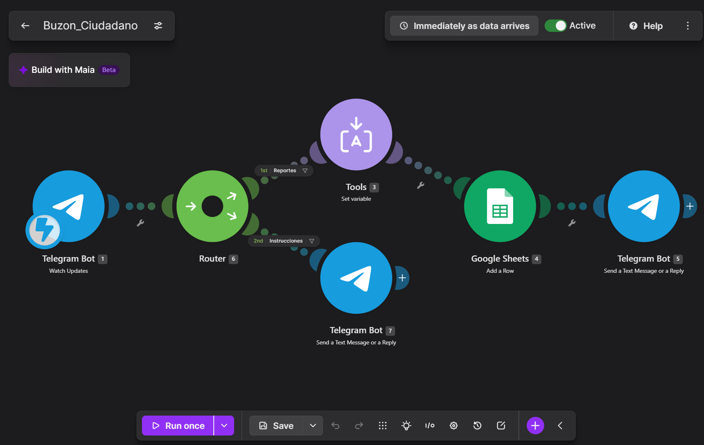
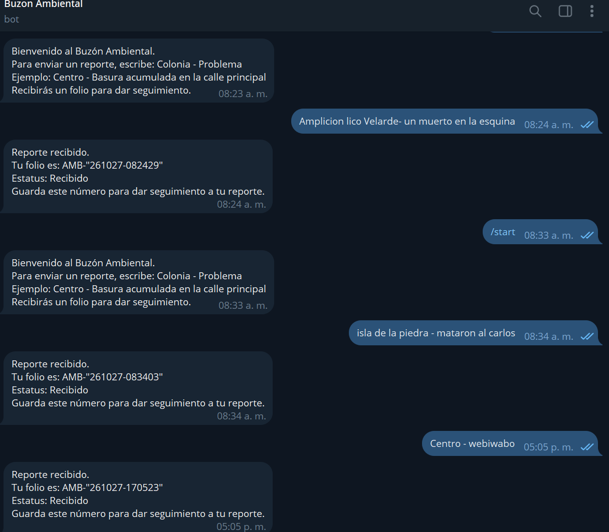

# Nombre del proyecto
Buzón Ciudadano con Folio

## Descripción
Bot de Telegram que funciona como buzón ciudadano ambiental. Recibe reportes de problemas ambientales de una colonia, y mediante Make los registra en Google Sheets con fecha, usuario y un folio único, y responde al ciudadano con su número de folio. Cuando el usuario envía /start, el bot responde con las instrucciones de uso.

## Objetivos de aprendizaje
Identificar qué organizaciones federales, estatales, municipales y sociales atienden los problemas ambientales en Mazatlán; comprender la importancia del folio como elemento de la participación ciudadana formal; construir, sin programar, un flujo de automatización que integre Telegram, Make y Google Sheets; aplicar filtros y routers para separar reportes de comandos; y reflexionar sobre la equidad en el acceso a canales digitales de participación y sobre lo que haría falta para que un buzón sea un canal formal.

## Material utilizado
- Celular con Telegram
- Bot creado con @BotFather
- Cuenta de Make (plan Pro del curso)
- Cuenta de Google (Google Sheets)
- Computadora con navegador

## Diagrama

## Imágenes

## Reporte
[Reporte](Resultados/Reporte_3.1_OrganizacionSocial.pdf)

## Video del funcionamiento
[Ver video en YouTube 📽️](https://youtube.com/shorts/awqnQVX7gQo?si=oGaYzOZBoE6zHmur)

## Conclusiones
El desarrollo de este proyecto permitió construir un buzón ciudadano funcional que combina Telegram, Make y Google Sheets para recibir, registrar y confirmar reportes ambientales con un folio. A lo largo del proceso se resolvieron detalles propios de este tipo de automatizaciones, como el filtro para no registrar comandos como reportes, el router para responder a /start, el mapeo correcto de columnas en la hoja y el formato del folio. La investigación de las organizaciones y la comparación con la denuncia popular de PROFEPA mostraron que el folio es el primer paso de un proceso formal, y que para que el buzón sea un canal formal hace falta una autoridad que reciba, responda y dé seguimiento en un plazo definido, además de otros canales para no excluir a quienes no tienen acceso digital.
