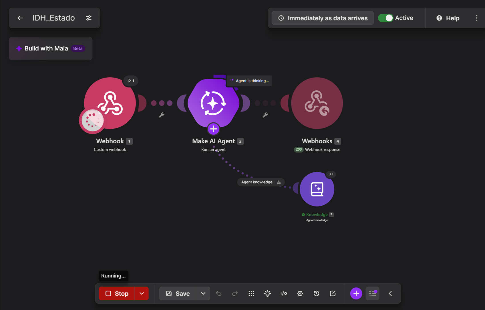
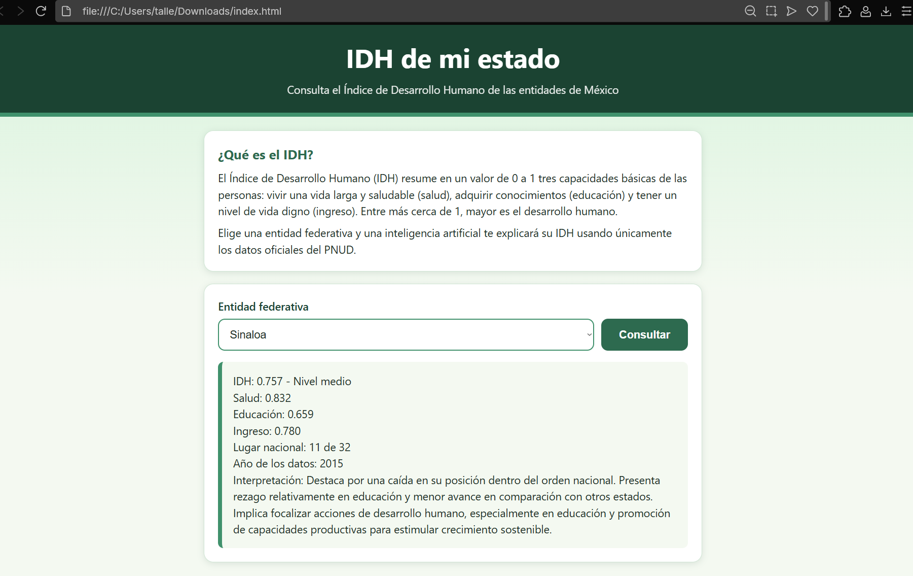

## Nombre del proyecto
IDH de mi estado

## Descripción
Página web donde cualquier persona elige una entidad federativa de México y consulta su Índice de Desarrollo Humano (IDH) con datos del PNUD. Al presionar "Consultar", la página envía la entidad mediante un webhook a Make; ahí un Make AI Agent busca en el archivo de conocimiento (IDH_entidades.pdf, con las tablas del informe del PNUD de 2015, datos de 2012) y devuelve, en texto plano, el IDH, los índices de salud, educación e ingreso, el lugar nacional, el año de los datos y una breve interpretación. Webhook Response regresa el texto a la página, que lo muestra en un recuadro.

## Objetivos de aprendizaje
Interpretar el IDH y sus tres componentes (salud, educación e ingreso) para las entidades de México; construir, sin programar el procesamiento, un flujo con Make (Webhooks, Make AI Agent y Webhook Response) conectado a una página web; comparar la respuesta del agente contra la tabla oficial para verificar que sea fiel a la fuente; y reflexionar sobre la justicia y la equidad en el desarrollo humano, las diferencias urbano-rurales que oculta un promedio estatal y el riesgo de decidir con datos antiguos.

## Material utilizado
- Computadora con navegador
- Cuenta de Make (plan Pro del curso, conexión Make's AI Provider)
- Informe del PNUD *Índice de Desarrollo Humano para las entidades federativas, México 2015* (Cuadros 2 y 3, páginas 9 a 11, guardadas como IDH_entidades.pdf)
- Archivo index.html (HTML, CSS y JavaScript)
- Cuenta de GitHub para publicar con GitHub Pages

## Página
[Abrir la página IDH de mi estado](Pagina/index.html)

## Diagrama
Escenario IDH_Estado en Make: Webhooks (Custom webhook) → Make AI Agent (con Knowledge) → Webhook Response.

## Imágenes

## Código
[Blueprint del escenario de Make](Codigo/IDH_Estado.blueprint.json)

## Reporte
[Reporte](Resultados/Reporte3.2_IDH_Estado.pdf)

## Video del funcionamiento
[Ver video](https://youtu.be/XIf5xnAKLQk?si=cQIAqqE1edD-YVge)

## Conclusiones
El proyecto permitió construir una página que consulta el IDH de las entidades de México a través de un flujo en Make, sin programar el procesamiento de los datos. Al comparar la respuesta del agente para Sinaloa con las tablas del PDF, coincidieron el IDH (0.757), la salud (0.832) y el lugar nacional (11 de 32), pero fallaron el nivel (dijo medio y corresponde a alto), la educación, el ingreso, el año de los datos y la interpretación, que ubicó el rezago en educación cuando es el mejor componente del estado y el mayor rezago está en salud. Esto mostró que una respuesta bien presentada no está verificada y que hay que contrastar cada cifra con la fuente. Además, el IDH permitió ver la brecha entre el Distrito Federal (0.830) y Chiapas (0.667), sobre todo en educación, y que el promedio de un estado oculta diferencias entre zonas urbanas y rurales; también mostró el riesgo de tomar decisiones con datos de 2012.
