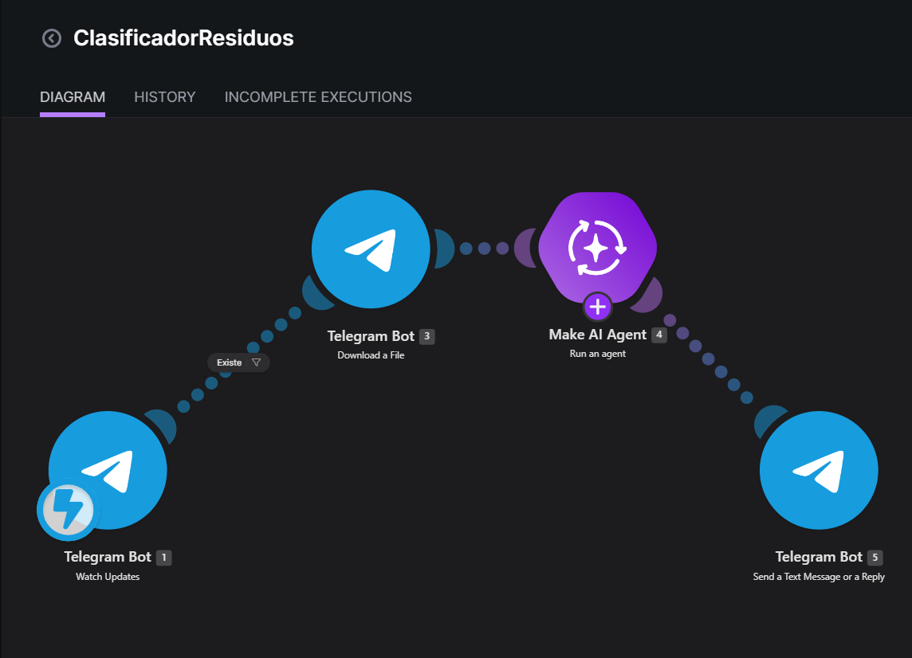
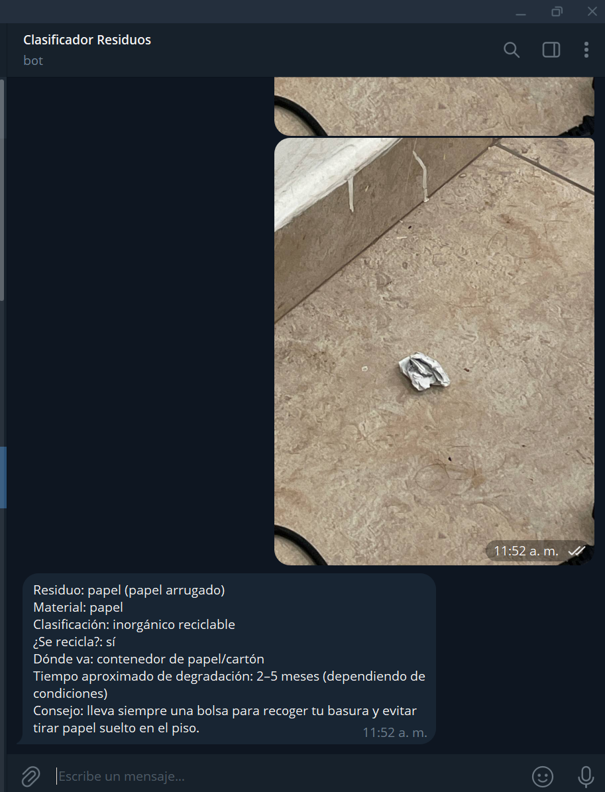

## Nombre del proyecto
Clasificador de residuos por foto

## Descripción
Bot de Telegram donde cualquier persona envía la foto de un residuo y recibe, en texto plano, qué es, su material, su clasificación (orgánico, inorgánico reciclable, inorgánico no reciclable o de manejo especial/peligroso), si se recicla, en qué contenedor o lugar de acopio va, su tiempo aproximado de degradación y un consejo para reducirlo o reutilizarlo. Al llegar una foto, Make la recibe mediante un webhook de Telegram (Watch Updates), la descarga (Download a File) y la envía a un Make AI Agent con visión, cuyas instrucciones lo configuran como asesor de separación de residuos para alumnos de Desarrollo Sustentable del TecNM en Mazatlán, Sinaloa. La respuesta del agente se devuelve al mismo chat con Send a Text Message or a Reply. Si la imagen no muestra un residuo o no se distingue, el bot pide otra foto más clara; si el residuo es peligroso (pilas, medicamentos, aceite, químicos), lo indica y recomienda no tirarlo a la basura común.

## Objetivos de aprendizaje
Identificar el impacto de los residuos que se generan en la vida diaria y cómo se clasifican en México; construir, sin programar el procesamiento, un flujo con Make (Telegram Bot, Make AI Agent con visión) conectado a un bot de Telegram; evaluar la precisión de la IA comparando sus respuestas (clasificación, si se recicla y tiempo de degradación) contra fuentes confiables; y reflexionar sobre la responsabilidad compartida entre ciudadanos, municipio y empresas en el reciclaje, y sobre el impacto de los residuos en el mar y los canales de la región.

## Material utilizado
- Celular con Telegram y cámara
- Computadora con navegador
- Cuenta de Make (plan Pro del curso, conexión Make's AI Provider)
- Bot de Telegram creado con @BotFather (el token no se comparte ni se sube a GitHub)
- 10 residuos distintos de la casa o del campus para fotografiar (limpios, sin manipular residuos peligrosos)
- Cuenta de GitHub para publicar el proyecto

## Diagrama
Escenario ClasificadorResiduos en Make: Telegram Bot (Watch Updates) → Filtro (la foto existe) → Telegram Bot (Download a File) → Make AI Agent (con visión) → Telegram Bot (Send a Text Message or a Reply).

## Imágenes

## Código
[Blueprint del escenario de Make](Codigo/ClasificadorResiduos.blueprint.json)

## Reporte
[Reporte](Resultado/Reporte3.3_ClasificadorResiduos.pdf)

## Video del funcionamiento
[Ver video](https://youtube.com/shorts/s0nuvBpqlK0?si=vxgMphNwhb3f7hAW)

## Conclusiones
El proyecto permitió construir un bot de Telegram que clasifica residuos a partir de una foto mediante un flujo en Make, sin programar el procesamiento de las imágenes. El filtro que exige que el mensaje contenga una foto evita que el escenario corra con texto, y la función last() toma la versión de mejor calidad entre los tamaños que envía Telegram. Al probar el bot con 10 residuos y comparar su clasificación, su indicación de reciclaje y su tiempo de degradación con fuentes confiables, se obtuvo un porcentaje de aciertos de [completar]%, con errores en [completar los casos], atribuibles a la calidad de la foto, a materiales mezclados o a la falta de contexto local. Esto mostró que una respuesta bien presentada no está verificada y que hay que contrastarla con la fuente. Además, la práctica hizo visible cuántos de los residuos de uso diario podrían reciclarse o compostarse y no se separan, el tiempo que tardan en degradarse los plásticos y el unicel, y su impacto al llegar al mar o a los canales de Mazatlán, lo que lleva a pensar en la responsabilidad compartida entre ciudadanos, municipio y fabricantes, y en un cambio concreto de consumo.
