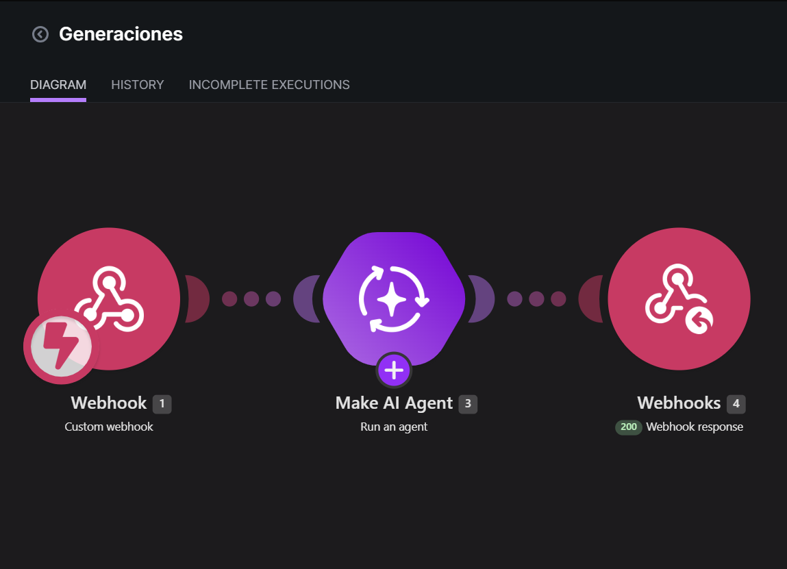
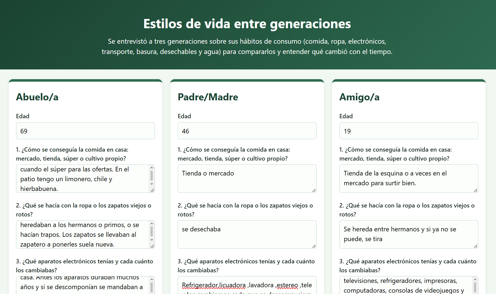

## Nombre del proyecto
Estilos de vida entre generaciones

## Descripción
Página web donde se capturan las respuestas de tres generaciones (abuelo/a, padre/madre y amigo/a) a las mismas 8 preguntas sobre hábitos de consumo: comida, ropa, electrónicos, transporte, basura, desechables, agua y qué consideran necesario para vivir bien. Al presionar "Comparar respuestas", la página verifica que todos los campos estén llenos y envía los tres textos (abuelo, padre y amigo) con fetch, por POST y como formulario (URLSearchParams), a un webhook de Make. Make recibe los datos con Webhooks (Custom webhook) y los pasa a un Make AI Agent, cuyas instrucciones lo configuran como analista de estilos de vida y consumo para alumnos de Desarrollo Sustentable del TecNM, y que usa únicamente lo que dicen las respuestas. El agente devuelve, en texto plano, una comparación por tema, un análisis y tres conclusiones, que Webhook Response regresa a la página para mostrarlas debajo del botón. Si ocurre un error, la página avisa que no se pudo obtener el análisis y pide intentar de nuevo. Las personas entrevistadas se registran solo por su edad, sin nombre ni otros datos personales.

## Objetivos de aprendizaje
Distinguir los estilos de vida y de consumo de tres generaciones del entorno familiar y comunitario; construir, sin programar el procesamiento, una página web conectada a Make y a un Make AI Agent para comparar las respuestas; y analizar con criterio propio las conclusiones de la IA, identificando qué dejó fuera o interpretó mal. También se busca formular conclusiones propias sobre la sustentabilidad de esos hábitos y su relación con la Carta de la Tierra y la Agenda 21.

## Material utilizado
- Computadora con navegador
- Cuenta de Make (plan Pro del curso, conexión Make's AI Provider; no requiere API key)
- Cuenta en una IA generativa gratuita para generar la página
- Cuenta de GitHub con el repositorio de prácticas (GitHub Pages)
- Tres personas a entrevistar: un abuelo o abuela, un padre o madre y un amigo o amiga de la misma edad

## Diagrama
Escenario Generaciones en Make: Webhooks (Custom webhook) → Make AI Agent → Webhooks (Webhook Response). Flujo completo: Página web → Make → Página web.

## Imágenes

## Código
[Blueprint del escenario de Make](Codigo/Generaciones.blueprint.json)

[Página web (index2.html) visible](https://escalantedelgadojorgeoswaldo-coder.github.io/Oswaldo/PRACTICAS/3.4_EstilosDeGeneraciones/Pagina/index2.html)
[Página web (index2.html) codigo](Pagina/index2.html)

## Reporte
[Reporte](Resultado/Reporte3.4_EstiloGeneraciones.pdf)

## Video del funcionamiento
[Ver video](https://youtu.be/crfhU-Lo5pw?si=wnLSpSyEmvk0BB4F)

## Conclusiones
El proyecto permitió construir una página web conectada a Make y a un Make AI Agent que compara los estilos de vida de tres generaciones a partir de las mismas 8 preguntas, sin programar el procesamiento de las respuestas. La validación de campos vacíos evita que se envíen entrevistas incompletas, y el envío como formulario (URLSearchParams) junto con el encabezado Access-Control-Allow-Origin permite que la página publicada en GitHub Pages reciba la respuesta de Make. Al comparar las entrevistas, la generación con el estilo de vida más sustentable fue [completar], por [convicción / necesidad], por ejemplo en [completar hábitos como reparar, reutilizar o comprar a granel]. Las diferencias de consumo se explican por cambios como la publicidad, la tecnología, el ingreso y el crecimiento de las ciudades. Sobre el análisis de la IA, coincidimos en [completar] y no en [completar], porque [completar qué dejó fuera o interpretó mal], lo que muestra que sus conclusiones deben revisarse con criterio propio. Estos hábitos se relacionan con los principios de la Carta de la Tierra y la Agenda 21 en [completar], y el hábito de generaciones anteriores que nos comprometemos a retomar es [completar], haciéndolo mediante [completar].
