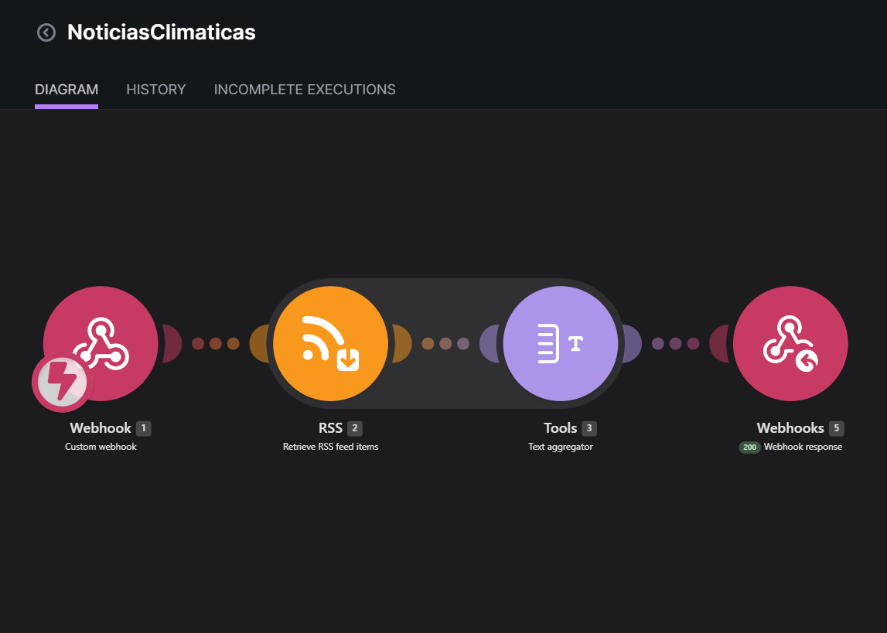
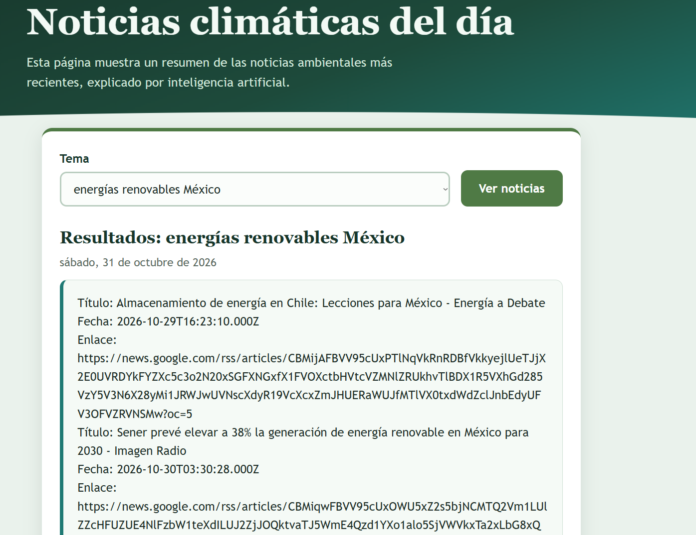

## Nombre del proyecto
Noticias climáticas del dia

## Descripción
Página web donde se captura [completar: tema, ciudad o palabra clave] para consultar noticias sobre el clima y el cambio climático. Al presionar el botón [completar: "Buscar noticias" / "Analizar"], la página verifica que los campos estén llenos y envía los datos con fetch, por POST y como formulario (URLSearchParams), a un webhook de Make. Make recibe los datos con Webhooks (Custom webhook) y los pasa a [completar: módulo que obtiene las noticias, por ejemplo HTTP / RSS] y después a un Make AI Agent, cuyas instrucciones lo configuran como analista de noticias climáticas para alumnos de Desarrollo Sustentable del TecNM, y que usa únicamente la información de las noticias recibidas. El agente devuelve, en texto plano, [completar: resumen de las noticias, análisis y conclusiones], que Webhook Response regresa a la página para mostrarlas debajo del botón. Si ocurre un error, la página avisa que no se pudo obtener el análisis y pide intentar de nuevo.

## Objetivos de aprendizaje
Identificar y resumir noticias relacionadas con el clima y el cambio climático; construir, sin programar el procesamiento, una página web conectada a Make y a un Make AI Agent para analizar noticias; y evaluar con criterio propio la respuesta de la IA, identificando qué dejó fuera o interpretó mal. También se busca relacionar las noticias con la sustentabilidad y con acciones que se pueden tomar en el entorno local.

## Material utilizado
- Computadora con navegador
- Cuenta de Make (plan Pro del curso, conexión Make's AI Provider; no requiere API key)
- Cuenta en una IA generativa gratuita para generar la página
- Cuenta de GitHub con el repositorio de prácticas (GitHub Pages)
- [completar: fuente de noticias utilizada, si aplica]

## Diagrama
Escenario Noticias Climáticas en Make: Webhooks (Custom webhook) → [completar: módulo de noticias] → Make AI Agent → Webhooks (Webhook Response). Flujo completo: Página web → Make → Página web.

## Imágenes

## Código
[Blueprint del escenario de Make](Codigo/NoticiasClimaticas.blueprint.json)

[Página web (index3.html) visible](https://escalantedelgadojorgeoswaldo-coder.github.io/Oswaldo/PRACTICAS/3.5_NoticiasClimaticas/Pagina/index3.html)

[Página web (index3.html) código](Pagina/index3.html)

## Reporte
[Reporte](Resultados/Reporte3.5_NoticiasClimaticas.pdf)

## Video del funcionamiento
[Ver video](https://youtu.be/crfhU-Lo5pw?si=wnLSpSyEmvk0BB4F)

## Conclusiones
El proyecto permitió construir una página web conectada a Make y a un Make AI Agent que analiza noticias climáticas, sin programar el procesamiento de la información. La validación de campos vacíos evita enviar consultas incompletas, y el envío como formulario (URLSearchParams) junto con el encabezado Access-Control-Allow-Origin permite que la página publicada en GitHub Pages reciba la respuesta de Make. Sobre el análisis de la IA, coincidimos en [completar] y no en [completar], porque [completar qué dejó fuera o interpretó mal], lo que muestra que sus conclusiones deben revisarse con criterio propio. Las noticias analizadas se relacionan con la sustentabilidad en [completar], y la acción que podemos tomar en nuestro entorno es [completar], haciéndolo mediante [completar].
