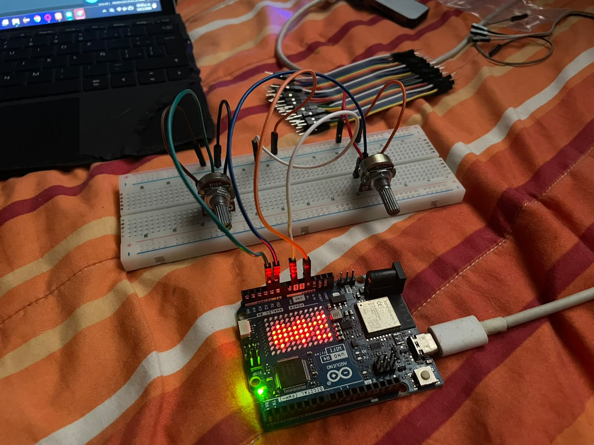
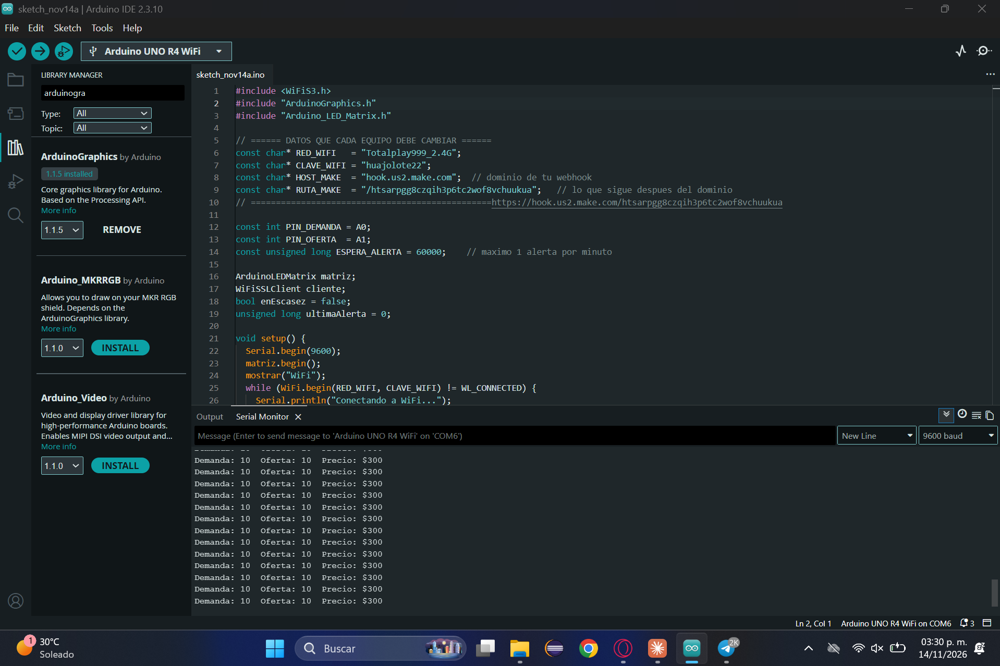

## Nombre del proyecto
Simulador de oferta y demanda con potenciómetros (Mercado)

## Descripción
Simulador físico de un mercado de camarón con un Arduino UNO R4 WiFi. Dos potenciómetros de 10 kΩ representan la demanda (entrada A0) y la oferta (entrada A1); el Arduino los lee, los convierte a una escala de 10 a 90 y calcula el precio de equilibrio de un modelo lineal (demanda P = a − Q, oferta P = Q − b), que muestra en su matriz LED y en el Monitor Serie. Cuando la demanda supera a la oferta en 25 puntos o más, el Arduino detecta escasez y llama por WiFi (HTTPS, método GET) al webhook de Make con los datos demanda, oferta, precio y estado. Make recibe los datos con Webhooks (Custom webhook) y los pasa a un módulo de Telegram Bot (Send a Text Message or a Reply) que envía al chat la alerta de escasez con la demanda, la oferta y el precio de equilibrio. La alerta se envía solo cuando el mercado pasa a escasez y como máximo una vez por minuto, para no gastar créditos de Make en cada lectura.

## Objetivos de aprendizaje
Explicar cómo la oferta y la demanda fijan los precios y relacionar la escasez de un recurso natural, como el camarón por una veda, con su precio; construir un sistema IoT que convierte un fenómeno económico en datos (lecturas analógicas), los muestra en una matriz LED y genera alertas automáticas con Make y Telegram; y reconocer lo que un modelo simple no considera (clima, combustible, importaciones y costo ambiental).

## Material utilizado
- Arduino UNO R4 WiFi con cable USB-C
- 2 potenciómetros de 10 kΩ (B10K), protoboard y cables jumper
- Computadora con Arduino IDE 2.3.10 y las librerías ArduinoGraphics y Arduino_LED_Matrix
- Red WiFi de 2.4 GHz con usuario y contraseña
- Cuenta de Make del curso (Webhooks) y Telegram (BotFather)

## Diagrama
Potenciómetros (A0 demanda, A1 oferta) → Arduino UNO R4 WiFi (calcula y muestra el precio) → Webhook de Make (Custom webhook) → Telegram Bot (alerta de escasez).

## Imágenes

Circuito armado:

Arduino IDE con el Monitor Serie (demanda 10, oferta 10, precio $300):

Alertas de escasez recibidas en Telegram:

## Código
[Blueprint del escenario de Make](Codigo/Mercado.blueprint.json)

[Código del Arduino (mercado.ino)](Codigo/mercado.ino)

> El sketch publicado debe llevar marcadores en lugar de la clave del WiFi y de la dirección del webhook (RED_WIFI, CLAVE_WIFI y RUTA_MAKE). Tampoco se sube el token del bot de Telegram.

## Reporte
[Reporte](Reporte/Reporte4.1_SimuladorOfertaDemanda.pdf)

## Video del funcionamiento
[Ver video](https://youtu.be/0H6pdf8JAno?si=yv7wlBmPn38EiMMJ)

## Conclusiones
El proyecto permitió convertir un fenómeno económico en datos y alertas automáticas: dos potenciómetros representan la oferta y la demanda, el Arduino calcula el precio de equilibrio, lo muestra en su matriz LED y, cuando la demanda supera a la oferta en 25 puntos o más, envía una alerta a Telegram a través de un webhook de Make. Con demanda 10 y oferta 10 el precio fue de $300 y no hubo alerta; con demanda 40, 90 y 67 y oferta 10 el precio fue de $360, $460 y $412 y llegaron tres alertas, valores que coinciden con la fórmula del programa. El modelo es lineal y deja fuera el clima, el costo del combustible, las importaciones y el costo ambiental de producir camarón, así que sirve para entender el equilibrio y no para pronosticar el precio real. La veda y los ejemplos de Sinaloa (camarón y jitomate) muestran que la escasez sube el precio, y que proteger el recurso con una veda es una decisión de sustentabilidad económica a largo plazo.
