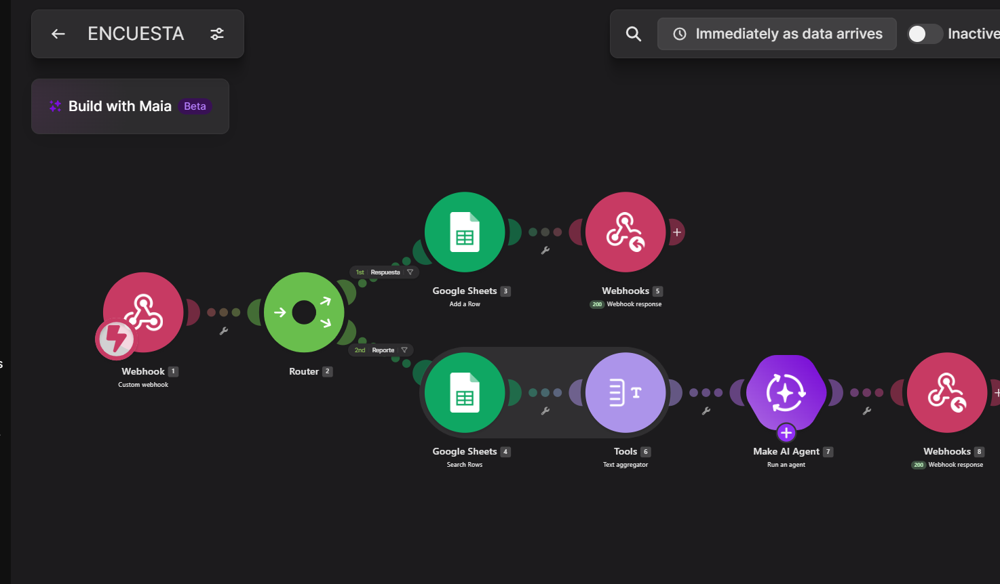
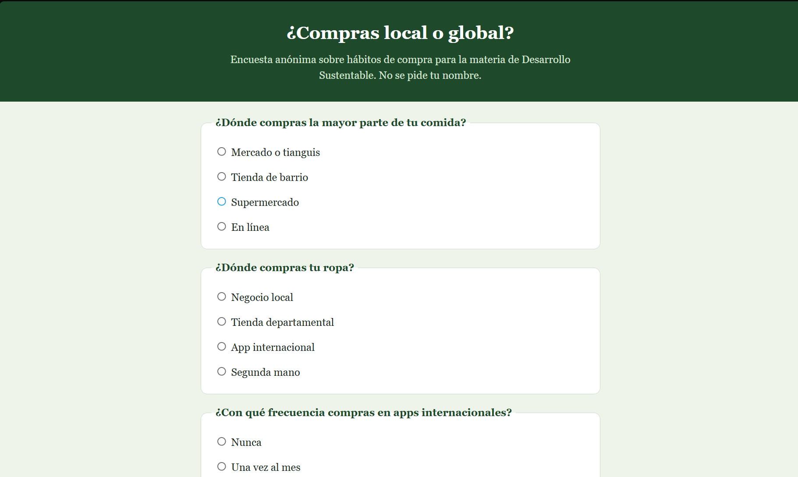

## Nombre del proyecto
Encuesta "¿Compras local o global?"

## Descripción
Página web donde se captura una encuesta anónima de seis preguntas de opción única (comida, ropa, frecuencia de compra en apps internacionales, criterio de compra, conocimiento del origen de lo que se compra y rango de edad) para conocer los hábitos de compra local y global de la comunidad. Al presionar el botón "Enviar respuesta", la página verifica que todas las preguntas estén contestadas y envía los datos con fetch, por POST y como formulario (URLSearchParams), a un webhook de Make. Make recibe los datos con Webhooks (Custom webhook) y un Router los separa según el campo accion: si es "respuesta", Google Sheets (Add a Row) guarda la respuesta en la hoja y Webhook Response confirma el registro; si es "reporte" (botón "Generar reporte"), Google Sheets (Search Rows) lee todas las respuestas, un Text aggregator las junta en un solo texto y se pasan a un Make AI Agent, cuyas instrucciones lo configuran como analista de economía local para alumnos de Desarrollo Sustentable del TecNM, y que usa únicamente las respuestas recibidas. El agente devuelve, en texto plano, el total de respuestas, los porcentajes por pregunta, un análisis y tres conclusiones, que Webhook Response regresa a la página para mostrarlas debajo de los botones. Si ocurre un error, la página avisa que no se pudo conectar y pide intentar de nuevo.

## Objetivos de aprendizaje
Identificar los hábitos de compra local y global de la comunidad y relacionarlos con la economía regional y el PIB; construir, sin programar el procesamiento, una página web conectada a Make, Google Sheets y un Make AI Agent para analizar los resultados de una encuesta; y verificar con criterio propio la respuesta de la IA, comparando sus porcentajes con los calculados en la hoja mediante fórmulas (COUNTIF). También se busca relacionar el consumo con la sustentabilidad y con acciones que se pueden tomar en el entorno local.

## Material utilizado
- Computadora y celular con navegador
- Cuenta de Make (plan Pro del curso, conexión Make's AI Provider; no requiere API key)
- Cuenta en una IA generativa gratuita para generar la página
- Cuenta de Google (Google Sheets) para guardar las respuestas
- Cuenta de GitHub con el repositorio de prácticas (GitHub Pages)
- 20 personas para encuestar (sin registrar nombres)

## Diagrama
Escenario ENCUESTA en Make: Webhooks (Custom webhook) → Router → Ruta 1 (accion = respuesta): Google Sheets (Add a Row) → Webhooks (Webhook Response) / Ruta 2 (accion = reporte): Google Sheets (Search Rows) → Tools (Text aggregator) → Make AI Agent → Webhooks (Webhook Response). Flujo completo: Página web → Make → Página web.

## Imágenes

## Código
[Blueprint del escenario de Make](Codigo/ENCUESTA.blueprint.json)

[Página web (index4.html) visible](https://escalantedelgadojorgeoswaldo-coder.github.io/Oswaldo/PRACTICAS/4.2_Encuesta/Pagina/index4.html)

[Página web (index4.html) código](Pagina/index4.html)

## Reporte
[Reporte](Reporte/Reporte4.2_Encuesta.pdf)

## Video del funcionamiento
[Ver video](https://youtu.be/1kSEfzZ-d5U?si=OrkMFUgRkzzjE1Wy)

## Conclusiones
El proyecto permitió construir una página web conectada a Make, a Google Sheets y a un Make AI Agent que analiza los resultados de una encuesta, sin programar el procesamiento de la información. La validación de preguntas sin contestar evita enviar respuestas incompletas, y el envío como formulario (URLSearchParams) junto con el encabezado Access-Control-Allow-Origin permite que la página publicada en GitHub Pages reciba la respuesta de Make. Sobre el análisis de la IA, la verificación de los porcentajes con fórmulas COUNTIF en Google Sheets muestra que sus conclusiones deben revisarse con criterio propio, ya que una IA puede equivocarse al contar aunque el reporte se vea convincente. Los hábitos de compra analizados se relacionan con la sustentabilidad en el efecto que tiene el consumo local sobre el empleo, el PIB de Mazatlán y el ambiente, porque comprar cerca reduce el transporte y los empaques. La acción que puedo tomar en mi entorno es impulsar el consumo local en mi colonia, haciéndolo mediante un directorio de negocios del barrio compartido en grupos vecinales y un día mensual de compra local.
