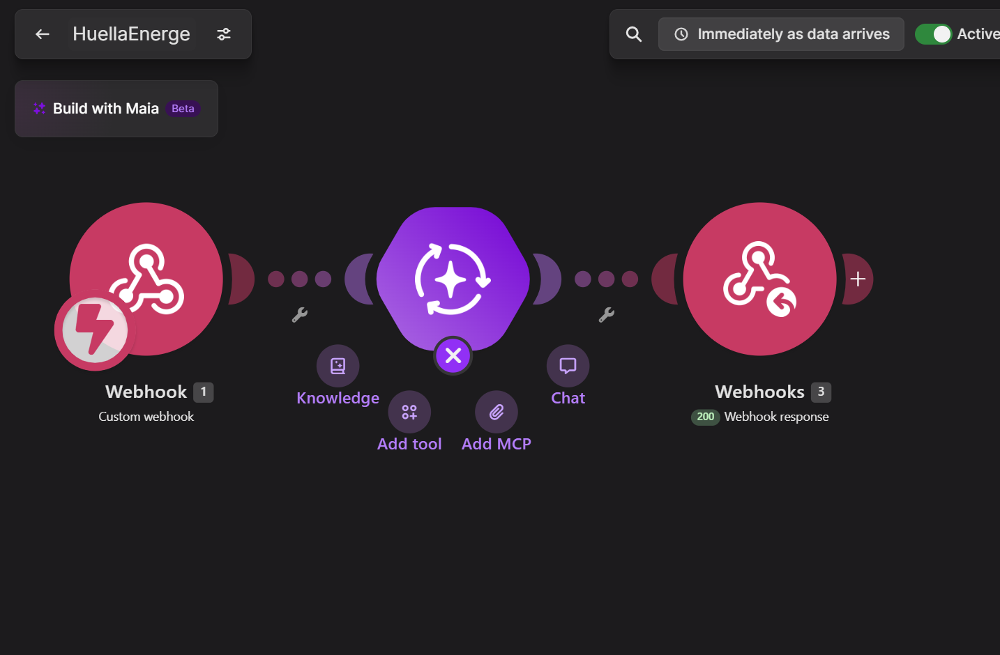
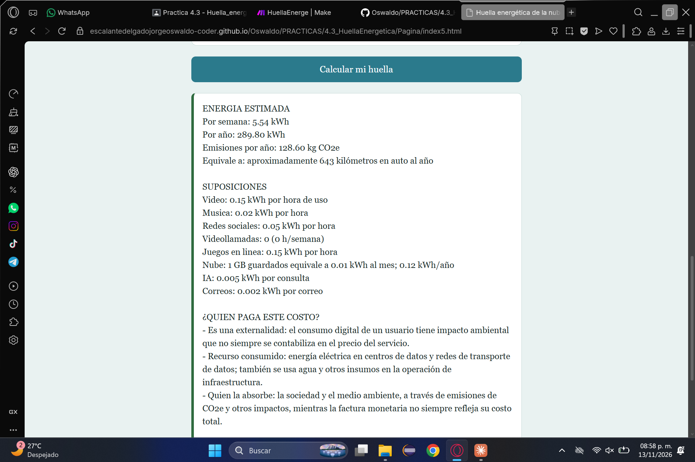

## Nombre del proyecto
Huella energética de la nube

## Descripción
Página web donde se capturan ocho datos de uso digital (horas al día de video en streaming, música en streaming, redes sociales y juegos en línea; horas a la semana de videollamadas; GB guardados en la nube; consultas al día a chatbots de IA y correos enviados al día) para estimar la huella energética de la nube. Al presionar el botón "Calcular mi huella", la página verifica que los campos estén llenos con números mayores o iguales a 0 y envía los datos con fetch, por POST y como formulario (URLSearchParams), a un webhook de Make. Make recibe los datos con Webhooks (Custom webhook) y los pasa a un Make AI Agent, cuyas instrucciones lo configuran como analista de sustentabilidad digital para alumnos de Desarrollo Sustentable del TecNM, que usa el factor de emisión del Sistema Eléctrico Nacional (0.444 kg CO2e por kWh, SEMARNAT 2024) y debe indicar los kWh por hora que supone para cada actividad. El agente devuelve, en texto plano, la energía estimada por semana y por año, las emisiones por año con una equivalencia, las suposiciones usadas, quién paga ese costo (la externalidad) y tres acciones para reducir la huella, que Webhook Response regresa a la página para mostrarlas debajo del botón. Si ocurre un error, la página avisa que no se pudo calcular y pide intentar de nuevo.

## Objetivos de aprendizaje
Reconocer el consumo energético de los servicios digitales como un costo externalizado, estimar la propia huella digital con apoyo de IA y evaluar críticamente las suposiciones de esa estimación comparándolas con fuentes. También se busca relacionar la externalización e internalización de costos con la sustentabilidad y con acciones que se pueden tomar en el uso cotidiano de la tecnología.

## Material utilizado
- Computadora con navegador y celular para revisar el tiempo de pantalla
- Cuenta de Make (plan Pro del curso, conexión Make's AI Provider; no requiere API key)
- Cuenta en una IA generativa gratuita para generar la página
- Cuenta de GitHub con el repositorio de prácticas (GitHub Pages)
- Fuentes consultadas: IEA y The Shift Project (energía del video en streaming) y SEMARNAT (factor de emisión del Sistema Eléctrico Nacional)

## Diagrama
Escenario Huella Energética en Make: Webhooks (Custom webhook) → Make AI Agent → Webhooks (Webhook Response). Flujo completo: Página web → Make → Página web.

## Imágenes

## Código
[Blueprint del escenario de Make](Codigo/HuellaEnerge.blueprint.json)

[Página web (index5.html) visible](https://escalantedelgadojorgeoswaldo-coder.github.io/Oswaldo/PRACTICAS/4.3_HuellaEnergetica/Pagina/index5.html)

[Página web (index5.html) código](Pagina/index5.html)

## Reporte
[Reporte](Reporte/Reporte4.3_HuellaEnergetica.pdf)

## Video del funcionamiento
[Ver video](https://youtu.be/1kSEfzZ-d5U?si=OrkMFUgRkzzjE1Wy)

## Conclusiones
El proyecto permitió construir una página web conectada a Make y a un Make AI Agent que estima la huella energética de los servicios digitales, sin programar el procesamiento de la información. La validación de campos vacíos evita enviar consultas incompletas, y el envío como formulario (URLSearchParams) junto con el encabezado Access-Control-Allow-Origin permite que la página publicada en GitHub Pages reciba la respuesta de Make. Sobre la estimación de la IA, la comparación del valor de kWh por hora de video con las fuentes (0.077 kWh según la IEA y 0.78 kWh según The Shift Project) muestra que sus suposiciones varían mucho y que sus conclusiones deben revisarse con criterio propio. El consumo de energía de la nube se relaciona con la sustentabilidad porque es una externalidad: su costo en emisiones y agua lo paga la sociedad y el ambiente, no quien usa el servicio. La acción que puedo tomar en mi entorno es reducir mi huella digital, haciéndolo mediante bajar la calidad del video cuando no hace falta, limpiar los archivos que guardo en la nube y usar la IA solo cuando la necesito.
