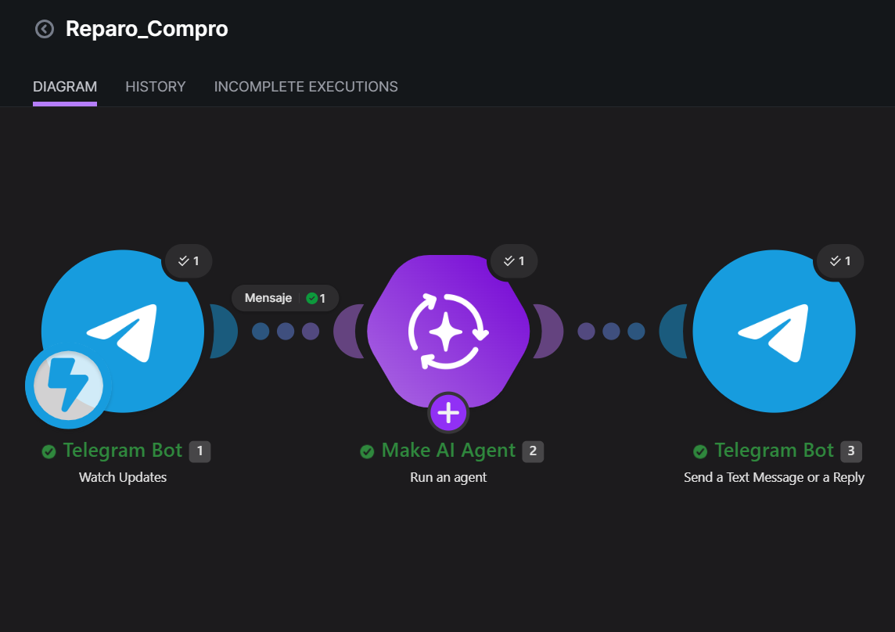
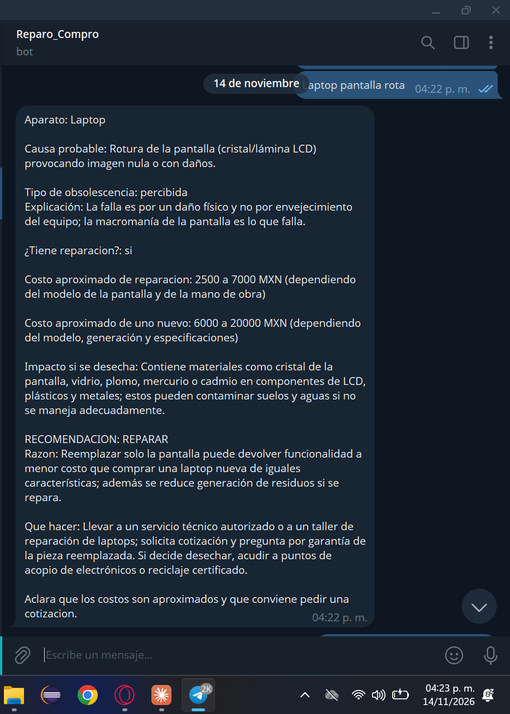
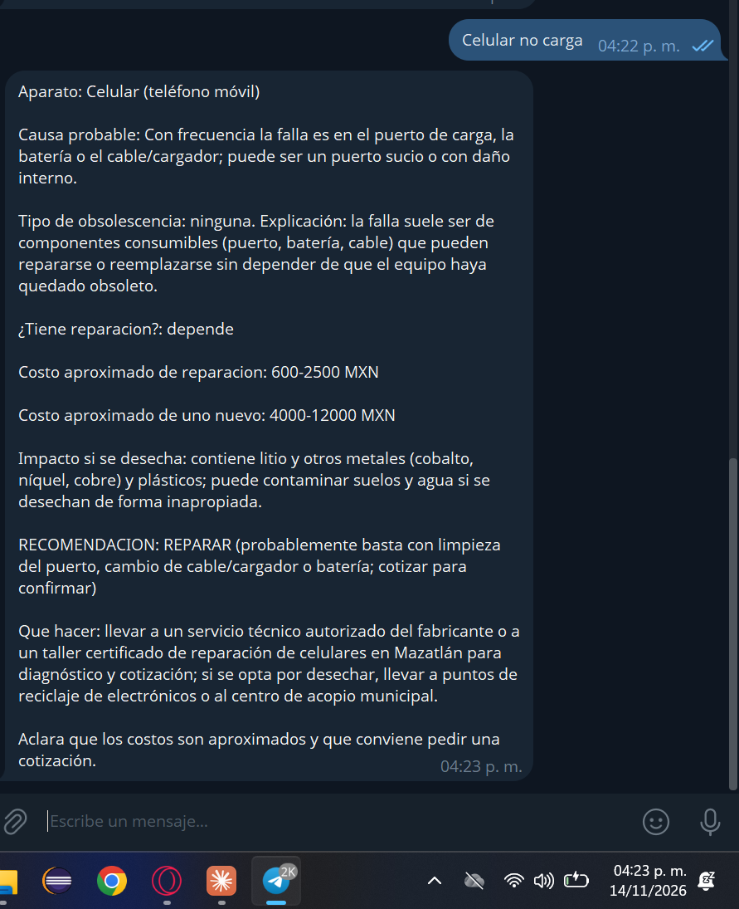

## Nombre del proyecto
Bot "¿Reparo o compro?"

## Descripción
Bot de Telegram que recibe la descripción de un aparato con falla (por ejemplo "licuadora sin potencia") y, con inteligencia artificial, recomienda si conviene reparar o reemplazar. Make recibe el mensaje con Telegram Bot (Watch Updates); un filtro deja pasar solo los mensajes que tienen texto y no empiezan con "/", para no gastar créditos con stickers, fotos o comandos. Después un Make AI Agent, configurado como asesor de reparación de aparatos para alumnos de Desarrollo Sustentable del TecNM en Mazatlán, responde en texto plano con el aparato, la causa probable, el tipo de obsolescencia (planificada, percibida o ninguna), si tiene reparación, el costo aproximado de reparar y de uno nuevo, el impacto si se desecha, una recomendación (REPARAR, REEMPLAZAR o DONAR O RECICLAR) y qué hacer. Telegram Bot (Send a Text Message or a Reply) devuelve esa respuesta al mismo chat. Las estimaciones de la IA se compararon con la cotización de un taller de Mazatlán.

## Objetivos de aprendizaje
Distinguir la obsolescencia planificada de la percibida en casos reales; valorar la reparación como alternativa de consumo que extiende la vida útil, ahorra dinero y evita residuos electrónicos; construir un bot de Telegram con Make y un Make AI Agent sin programar el procesamiento; y verificar con información local (un taller de reparación de Mazatlán) las recomendaciones de una IA.

## Material utilizado
- Celular con Telegram y computadora con navegador
- Bot creado con BotFather
- Cuenta de Make del curso (conexión Make's AI Provider; no requiere API key)
- Aparatos con falla (laptop, celular, licuadora y [completar: aparatos 4 a 6]) para probar el bot
- Taller de reparación de Mazatlán: [completar: nombre del taller y fecha de la consulta]

## Diagrama
Escenario Reparo_Compro en Make: Telegram Bot (Watch Updates) → filtro (Text Exists y Does not start with /) → Make AI Agent → Telegram Bot (Send a Text Message or a Reply).

## Imágenes

Respuesta del bot a "Laptop pantalla rota":

Respuesta del bot a "Celular no carga":

## Código
[Blueprint del escenario de Make](Codigo/Reparo_Compro.blueprint.json)

## Reporte
[Reporte](Reporte/Reporte4.4_ReparoCompro.pdf)

## Video del funcionamiento
[Ver video]([completar: enlace del video])

## Conclusiones
El bot de Telegram conectado a Make y a un Make AI Agent respondió en segundos con un diagnóstico probable, el tipo de obsolescencia, un costo aproximado y una recomendación para cada aparato, y el filtro evitó gastar créditos con mensajes que no eran texto o que eran comandos. Sobre el análisis de la IA, coincidimos en [completar: qué estimaciones coincidieron con el taller] y no en [completar: cuáles no], porque, por ejemplo, la IA clasificó una laptop con pantalla rota como obsolescencia percibida cuando era un daño físico y dio rangos de costo muy amplios (de $2,500 a $7,000 para reparar la pantalla), lo que muestra que sus conclusiones deben revisarse con criterio propio y contrastarse con una cotización real. La obsolescencia, planificada o percibida, aumenta los residuos electrónicos; la acción que podemos tomar en nuestro entorno es [completar: acción, por ejemplo preguntar antes de tirar un aparato], haciéndolo mediante [completar: cómo, por ejemplo llevarlo a un taller y pedir cotización].
